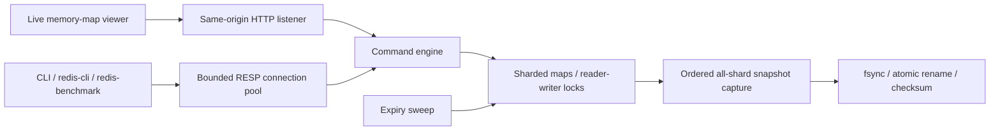
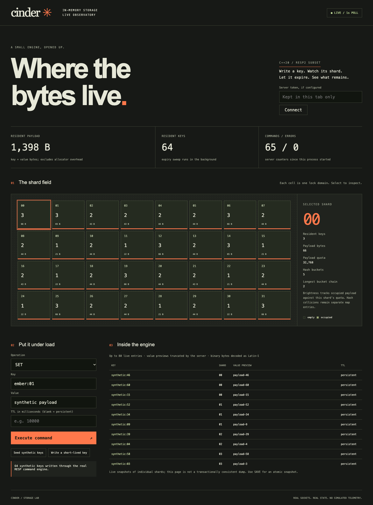

# Cinder

## Problem

An in-memory key-value store must keep atomic operations, expiry and snapshots correct when clients contend for the same keys.

## Results

- Cinder SET: **105,634 ops/s**, median run p99 **0.143 ms**; GET: **105,263 ops/s**, **0.143 ms**.
- Same-machine Redis GET: **110,294 ops/s**, median run p99 **0.183 ms**. These rows use 3 trials, 30,000 requests/test, 16 clients, no pipelining, 128-byte values.
- **8,163 core checks**, including 4,000 reference-model steps and 10,000 parser fuzz cases; **60 × 9-operation** real concurrent histories accepted, stale-read negative control rejected.

Source: [raw benchmark CSVs and summary](docs/results/benchmark/), [core output](docs/results/core.log), [socket histories](docs/results/build/histories.json). Apple M2 Pro, 16 GiB RAM, macOS arm64; exact specs/compiler/config in the benchmark summary. Redis is a pinned historical 7.2.4 baseline, both built with libc/system allocators. Three trials are finite laptop measurements; neither CPU affinity nor a dedicated host. p99 values are medians of individual-run p99s, not a pooled percentile. Client and server share the machine. [Full comparison and caveats](docs/BENCHMARKS.md).

[ASan](docs/results/asan-final.log), [TSan](docs/results/tsan-final.log), [socket tests](docs/results/test.log), [dependency scan](docs/results/dependency-scan.log). macOS ASan uses leak detection disabled because LeakSanitizer is unavailable; Linux CI enables it. [CI runs](https://github.com/rjrddy/cinder/actions). [Quality report](docs/QUALITY.md).

Caught failures: malformed RESP and quota/invalid writes were rejected without changing the old value ([raw cases](docs/results/build/caught-failures.json)); a byte-flipped snapshot prevented startup ([actual fatal log](docs/results/build/corruption-rejected.log)). Linux CI also caught a real shutdown flag data race ([failing TSan log](docs/results/initial-linux-tsan-race.log)); it was fixed with a lock-free atomic flag, without suppressions. Reproduce the regression gate with `make tsan`. Other fault cases reproduce with `make test`. These are successful negative tests; retained tooling/harness failures are explained in [results notes](docs/results/NOTES.md).

## Architecture





## Run it

Prerequisites: C++20 compiler, CMake, Make, Python and Node. The demo installs pinned developer tools and seeds synthetic keys. Native server and viewer run locally; Ctrl-C stops them.

```sh
make demo
# Open http://127.0.0.1:8084
python3 scripts/client.py GET synthetic:00
```

Checks: `make lint test`; sanitizer gates: `make asan` and `make tsan`. Benchmark: `make bench REDIS_BIN=/absolute/path/to/redis/src` after building the documented pinned baseline. [Benchmark reproduction](docs/BENCHMARKS.md), [ninety-second demo steps](docs/DEMO.md), [actual browser proof](docs/results/browser/verification.json).

## Decisions and limits

Per-shard shared locks and owned read copies prioritize inspectable lifetime/thread safety. Bucket collisions use full-key equality. INCR and NX are atomic under one exclusive lock. Payload accounting excludes allocator/node/stack overhead and is not an RSS limit. Quotas are per shard, so a hot shard can fill while others have spare capacity. TTL uses Unix time and is sensitive to clock adjustments. SAVE captures one state, then writes off-lock; changes after the last successful SAVE are lost on crash. Checksum detects accidental corruption, not malicious edits. Viewer totals are observational across shards. [Design and guarantees](docs/DESIGN.md), [ADRs](docs/adr/), [protocol subset](docs/PROTOCOL.md), [migration provenance](docs/migration/cinder.md).

This is a bounded local storage lab: no lock-free claim, replication, WAL, transactions, tenant isolation, RESP3 or general Redis compatibility. Native workers hold connections and can be occupied by slow clients. No hosted performance or availability has been measured. The prepared [Render free-plan config](render.yaml) is **not deployed** and has ephemeral storage; [deployment limits](docs/DEPLOY.md). No account was created and no employer code/data was used. [Interview walkthrough](INTERVIEW.md), [follow-up drill](DRILL.md).

## Next

Measure an event-loop frontend, incremental expiry and allocator-aware memory use before changing the concurrency design; then add a WAL with crash-point tests and a monotonic in-process TTL clock. Integration with Tidal waits until both projects independently pass.
